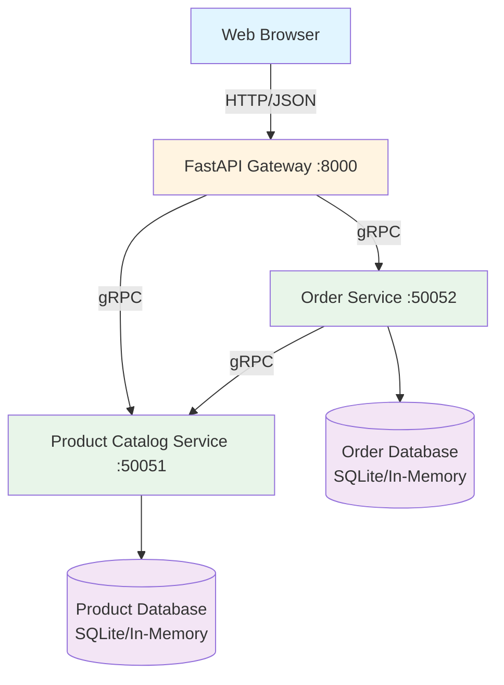
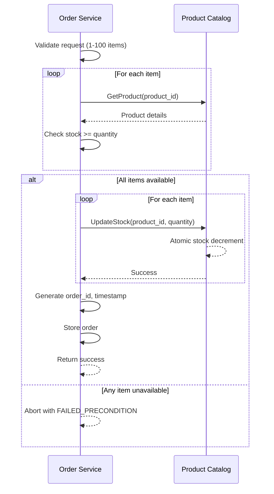

# Technical Design Document: E-Commerce Microservices

## Overview

This document provides the technical design for an e-commerce web application built using a microservices architecture. The system consists of two independent gRPC-based backend services (Product Catalog and Order Management), a FastAPI-based HTTP gateway for browser communication, and a modern frontend built with HTML and Tailwind CSS.

### System Goals

- **Service Independence**: Each microservice operates autonomously with its own data storage
- **Performance**: Binary Protocol Buffer serialization for efficient inter-service communication
- **Simplicity**: Straightforward deployment without container orchestration for local development
- **User Experience**: Responsive, modern web interface for browsing products and managing orders

### Key Design Decisions

**gRPC for Inter-Service Communication**: Protocol Buffers provide type-safe contracts between services with efficient binary serialization. This is [appropriate for internal service communication](https://grpc.io/docs/guides/error/) where performance and schema evolution matter.

**FastAPI Gateway Pattern**: Since browsers cannot directly communicate with gRPC services, we use a FastAPI gateway to translate HTTP/JSON requests into gRPC calls. This pattern is [commonly used in microservices architectures](https://medium.com/fastapi-grpc-integration) to bridge web clients and gRPC backends.

**Synchronous Stock Management**: For this simplified system, we use synchronous gRPC calls from Order Service to Product Catalog Service for stock validation and updates. In production systems, this would typically use the [Saga pattern with compensating transactions](https://oneuptime.com/blog/post/2026-01-24-saga-pattern-transactions/view) or event-driven orchestration, but for local development, the synchronous approach provides sufficient consistency.

**SQLite/In-Memory Storage**: Both services use either SQLite or in-memory storage, eliminating the need for external database setup during local development.

## Architecture

### High-Level Architecture Diagram



### Service Boundaries

**Product Catalog Service** (Port 50051)
- Owns product data: ID, name, description, price, stock quantity, image URL
- Provides read operations for product listing and individual product retrieval
- Provides stock update operations with validation
- Independent SQLite or in-memory storage

**Order Service** (Port 50052)
- Owns order data: order ID, timestamp, line items, total
- Orchestrates order creation by validating stock and updating inventory
- Provides order history retrieval
- Communicates with Product Catalog Service via gRPC for stock operations
- Independent SQLite or in-memory storage

**Web Gateway** (Port 8000)
- Stateless HTTP/JSON API for browser clients
- Maintains gRPC client connections to both backend services
- Translates HTTP requests to gRPC calls and responses back to JSON
- Serves HTML templates using Jinja2
- Error translation from gRPC status codes to HTTP status codes

### Communication Patterns

**Browser to Gateway**: HTTP/JSON over REST-style endpoints
- GET /api/products → List all products
- GET /api/orders → List all orders
- POST /api/orders → Create new order

**Gateway to Services**: gRPC with Protocol Buffer messages
- Persistent connection pooling for performance
- 5-10 second timeouts on gRPC calls
- gRPC error code handling and translation

**Order Service to Product Catalog**: gRPC for stock operations
- Synchronous call pattern for stock validation
- Synchronous call pattern for stock updates
- Atomic operations within Product Catalog Service

## Components and Interfaces

### 1. Protocol Buffer Definitions

#### product.proto

```protobuf
syntax = "proto3";

package ecommerce.product;

// Product Catalog Service
service ProductCatalogService {
  rpc ListProducts(Empty) returns (ProductList);
  rpc GetProduct(ProductRequest) returns (Product);
  rpc UpdateStock(StockUpdateRequest) returns (StockUpdateResponse);
}

message Empty {}

message Product {
  string id = 1;
  string name = 2;
  string description = 3;
  double price = 4;
  int32 stock = 5;
  string image_url = 6;
}

message ProductList {
  repeated Product products = 1;
}

message ProductRequest {
  string product_id = 1;
}

message StockUpdateRequest {
  string product_id = 1;
  int32 decrement = 2;
}

message StockUpdateResponse {
  bool success = 1;
  int32 new_stock = 2;
}
```

#### order.proto

```protobuf
syntax = "proto3";

package ecommerce.order;

// Order Service
service OrderService {
  rpc CreateOrder(OrderRequest) returns (OrderResponse);
  rpc ListOrders(Empty) returns (OrderList);
}

message Empty {}

message LineItem {
  string product_id = 1;
  int32 quantity = 2;
  string product_name = 3;
  double unit_price = 4;
}

message OrderRequest {
  repeated LineItem items = 1;
}

message OrderResponse {
  string order_id = 1;
  string timestamp = 2;
  bool success = 3;
  string message = 4;
  repeated string out_of_stock_products = 5;
}

message Order {
  string order_id = 1;
  string timestamp = 2;
  repeated LineItem items = 3;
  double total = 4;
}

message OrderList {
  repeated Order orders = 1;
}
```

**Proto Compilation**:
```bash
python -m grpc_tools.protoc -I./protos --python_out=. --grpc_python_out=. protos/product.proto
python -m grpc_tools.protoc -I./protos --python_out=. --grpc_python_out=. protos/order.proto
```

This generates:
- `product_pb2.py` - Product message classes
- `product_pb2_grpc.py` - Product service stub and servicer
- `order_pb2.py` - Order message classes
- `order_pb2_grpc.py` - Order service stub and servicer

### 2. Product Catalog Service

**Technology**: Python with grpcio

**Data Model**:
```python
{
    "id": "uuid-string",
    "name": "string (max 200 chars)",
    "description": "string (max 1000 chars)",
    "price": "float (0.01 to 999999.99)",
    "stock": "int (0 to 999999)",
    "image_url": "string (max 500 chars)"
}
```

**Storage Options**:
- SQLite with schema: `CREATE TABLE products (id TEXT PRIMARY KEY, name TEXT, description TEXT, price REAL, stock INTEGER, image_url TEXT)`
- In-memory dictionary: `products: Dict[str, Product]`

**Service Implementation**:

```python
class ProductCatalogServicer(product_pb2_grpc.ProductCatalogServiceServicer):
    def ListProducts(self, request, context):
        # Return all products from storage
        
    def GetProduct(self, request, context):
        # Lookup product by ID
        # If not found: context.abort(grpc.StatusCode.NOT_FOUND, "Product not found")
        
    def UpdateStock(self, request, context):
        # Validate product exists
        # Validate decrement <= current stock
        # Update stock atomically
        # On insufficient stock: context.abort(grpc.StatusCode.FAILED_PRECONDITION, "Insufficient stock")
```

**Error Handling**:
- `NOT_FOUND`: Product ID does not exist
- `FAILED_PRECONDITION`: Stock decrement exceeds available quantity
- `INVALID_ARGUMENT`: Malformed request (negative stock, invalid ID format)

**Startup Behavior**:
- Load or initialize storage
- Seed with sample data if storage is empty
- Start gRPC server on port 50051

### 3. Order Service

**Technology**: Python with grpcio

**Data Model**:
```python
{
    "order_id": "uuid-v4-string",
    "timestamp": "ISO-8601-string",
    "items": [
        {
            "product_id": "string",
            "quantity": "int (1-1000)",
            "product_name": "string",
            "unit_price": "float"
        }
    ],
    "total": "float (sum of quantity * unit_price)"
}
```

**Storage Options**:
- SQLite with tables: `orders` and `order_items`
- In-memory list: `orders: List[Order]`

**Service Implementation**:

```python
class OrderServiceServicer(order_pb2_grpc.OrderServiceServicer):
    def __init__(self):
        # Initialize gRPC client stub to Product Catalog Service
        self.product_channel = grpc.insecure_channel('localhost:50051')
        self.product_stub = product_pb2_grpc.ProductCatalogServiceStub(self.product_channel)
        
    def CreateOrder(self, request, context):
        # 1. Validate request (1-100 items, quantities 1-1000)
        # 2. For each line item:
        #    - Call product_stub.GetProduct() with 5s timeout
        #    - Verify stock availability
        #    - Collect product names and prices
        # 3. If all validations pass:
        #    - For each item, call product_stub.UpdateStock() with 5s timeout
        #    - On any failure, abort with FAILED_PRECONDITION
        # 4. Generate UUID order_id and ISO-8601 timestamp
        # 5. Store order
        # 6. Return success response
        
    def ListOrders(self, request, context):
        # Return all orders from storage
```

**Order Creation Flow**:


**Error Handling**:
- `INVALID_ARGUMENT`: Empty item list, >100 items, quantity out of range
- `FAILED_PRECONDITION`: Insufficient stock (return list of affected product IDs)
- `UNAVAILABLE`: Product Catalog Service unreachable or timeout
- `NOT_FOUND`: Product ID does not exist in catalog

**gRPC Client Configuration**:
```python
options = [
    ('grpc.keepalive_time_ms', 30000),
    ('grpc.keepalive_timeout_ms', 10000),
]
channel = grpc.insecure_channel('localhost:50051', options=options)
```

### 4. Web Gateway (FastAPI)

**Technology**: FastAPI, Uvicorn, Jinja2

**gRPC Client Management**:
```python
@asynccontextmanager
async def lifespan(app: FastAPI):
    # Startup: Create gRPC channels and stubs
    app.state.product_channel = grpc.insecure_channel('localhost:50051')
    app.state.product_stub = product_pb2_grpc.ProductCatalogServiceStub(app.state.product_channel)
    
    app.state.order_channel = grpc.insecure_channel('localhost:50052')
    app.state.order_stub = order_pb2_grpc.OrderServiceStub(app.state.order_channel)
    
    yield
    
    # Shutdown: Close channels
    app.state.product_channel.close()
    app.state.order_channel.close()

app = FastAPI(lifespan=lifespan)
```

**API Endpoints**:

**GET /api/products**
- Calls `product_stub.ListProducts()`
- Timeout: 10 seconds
- Success: Returns JSON array of products with 200 status
- Failure: Returns 503 with error message if service unavailable

**POST /api/orders**
- Request body: `{"items": [{"product_id": "...", "quantity": 1}, ...]}`
- Calls `order_stub.CreateOrder()`
- Timeout: 15 seconds
- Success (200): `{"order_id": "...", "timestamp": "..."}`
- Client error (400): Invalid JSON or missing fields
- Stock error (412): `{"message": "Insufficient stock", "out_of_stock": ["id1", "id2"]}`
- Service error (503): `{"message": "Order service unavailable"}`

**GET /api/orders**
- Calls `order_stub.ListOrders()`
- Timeout: 30 seconds
- Success: Returns JSON array of orders with 200 status
- Failure: Returns 503 with error message if service unavailable

**GET /** (HTML routes)
- Renders Jinja2 templates for storefront and order history pages
- Serves static assets if needed

**Error Translation Table**:

| gRPC Status Code | HTTP Status | JSON Message |
|-----------------|-------------|--------------|
| OK | 200 | Success response |
| NOT_FOUND | 404 | "Resource not found" |
| INVALID_ARGUMENT | 400 | "Invalid request" |
| FAILED_PRECONDITION | 412 | "Precondition failed: {details}" |
| UNAVAILABLE | 503 | "{Service} is unavailable" |
| DEADLINE_EXCEEDED | 503 | "Request timeout" |

**Implementation Pattern**:
```python
@app.get("/api/products")
async def get_products(request: Request):
    try:
        response = request.app.state.product_stub.ListProducts(
            product_pb2.Empty(),
            timeout=10
        )
        products = [
            {
                "id": p.id,
                "name": p.name,
                "description": p.description,
                "price": p.price,
                "stock": p.stock,
                "image_url": p.image_url
            }
            for p in response.products
        ]
        return JSONResponse(content=products)
    except grpc.RpcError as e:
        if e.code() == grpc.StatusCode.UNAVAILABLE:
            return JSONResponse(
                status_code=503,
                content={"message": "Product service is unavailable"}
            )
        # Handle other error codes...
```

### 5. Frontend (HTML + Tailwind CSS + JavaScript)

**Technology**: 
- HTML5
- Tailwind CSS 3.x (CDN)
- Vanilla JavaScript (Fetch API)

**Storefront Page (index.html)**

**Layout**:
- Responsive grid: 1 column (<640px), 2 columns (640-1023px), 3+ columns (≥1024px)
- Product cards with image, name, description, price, stock, "Add to Cart" button
- Shopping cart sidebar/slide-over panel
- Search/filter input field

**JavaScript State Management**:
```javascript
let cart = {}; // { product_id: { product, quantity } }

async function loadProducts() {
    try {
        const response = await fetch('/api/products', { signal: AbortSignal.timeout(10000) });
        if (!response.ok) {
            throw new Error('Failed to load products');
        }
        const products = await response.json();
        renderProducts(products);
    } catch (error) {
        showError('Unable to load products. Please try again later.');
    }
}

function addToCart(product) {
    if (product.stock === 0) return;
    
    if (cart[product.id]) {
        if (cart[product.id].quantity < product.stock) {
            cart[product.id].quantity++;
        } else {
            showError(`Only ${product.stock} available`);
            return;
        }
    } else {
        cart[product.id] = { product, quantity: 1 };
    }
    
    updateCartUI();
}

async function checkout() {
    if (Object.keys(cart).length === 0) return;
    
    const items = Object.values(cart).map(item => ({
        product_id: item.product.id,
        quantity: item.quantity
    }));
    
    try {
        const response = await fetch('/api/orders', {
            method: 'POST',
            headers: { 'Content-Type': 'application/json' },
            body: JSON.stringify({ items }),
            signal: AbortSignal.timeout(15000)
        });
        
        if (response.ok) {
            const order = await response.json();
            showSuccess(`Order ${order.order_id} placed successfully!`);
            cart = {};
            updateCartUI();
        } else if (response.status === 412) {
            const error = await response.json();
            showError(`Out of stock: ${error.out_of_stock.join(', ')}`);
        } else if (response.status === 503) {
            showError('Service temporarily unavailable. Please try again later.');
        } else {
            showError('Failed to place order. Please try again.');
        }
    } catch (error) {
        if (error.name === 'TimeoutError') {
            showError('Request timed out. Please try again.');
        } else {
            showError('An error occurred. Please try again.');
        }
    }
}
```

**Order History Page (orders.html)**

**Layout**:
- List of orders, each showing:
  - Order ID
  - Timestamp (ISO 8601 format)
  - Line items table (product name, quantity, unit price)
  - Total amount

**JavaScript**:
```javascript
async function loadOrders() {
    try {
        const response = await fetch('/api/orders', { signal: AbortSignal.timeout(30000) });
        
        if (!response.ok) {
            if (response.status === 503) {
                showError('Order service is currently unavailable. Please try again later.');
            } else {
                showError('An error occurred while loading orders. Please try again.');
            }
            return;
        }
        
        const orders = await response.json();
        
        if (orders.length === 0) {
            showMessage('No orders yet');
        } else {
            renderOrders(orders);
        }
    } catch (error) {
        if (error.name === 'TimeoutError') {
            showError('Request timed out. Please try again.');
        } else if (error instanceof SyntaxError) {
            showError('Failed to load order data. Please refresh the page.');
        } else {
            showError('An error occurred. Please try again.');
        }
    }
}
```

**UI Components** (Tailwind CSS):
- Product card: `border rounded-lg shadow-md p-4 hover:shadow-lg`
- Cart panel: `fixed right-0 top-0 h-full bg-white shadow-xl`
- Buttons: `bg-blue-600 hover:bg-blue-700 text-white font-semibold py-2 px-4 rounded`
- Out of stock badge: `bg-red-100 text-red-800 text-xs font-semibold px-2 py-1 rounded`

## Data Models

### Product Entity

| Field | Type | Constraints | Description |
|-------|------|-------------|-------------|
| id | string | UUID format, unique | Product identifier |
| name | string | 1-200 characters | Product name |
| description | string | 0-1000 characters | Product description |
| price | float | 0.01-999999.99 | Unit price in currency |
| stock | integer | 0-999999 | Available quantity |
| image_url | string | 0-500 characters, URL format | Product image |

### Order Entity

| Field | Type | Constraints | Description |
|-------|------|-------------|-------------|
| order_id | string | UUID v4 format, unique | Order identifier |
| timestamp | string | ISO 8601 format | Order creation time |
| items | array | 1-100 line items | Order line items |
| total | float | Calculated field | Sum of all line totals |

### Line Item Entity

| Field | Type | Constraints | Description |
|-------|------|-------------|-------------|
| product_id | string | UUID format, references Product | Product identifier |
| quantity | integer | 1-1000 | Quantity ordered |
| product_name | string | Copied from Product | Product name snapshot |
| unit_price | float | Copied from Product | Price snapshot |

**Data Integrity Rules**:
- Order line items capture product name and price at order time (not foreign keys)
- Stock updates are atomic within Product Catalog Service
- Order creation is all-or-nothing (either all stock updates succeed or order is not created)

## Error Handling

### gRPC Error Codes

The system uses [standard gRPC status codes](https://grpc.io/docs/guides/error/) for service-to-service communication:

**Product Catalog Service**:
- `OK`: Operation successful
- `NOT_FOUND`: Product ID does not exist
- `FAILED_PRECONDITION`: Stock update would result in negative inventory
- `INVALID_ARGUMENT`: Malformed request (invalid ID, negative values)

**Order Service**:
- `OK`: Order created successfully
- `INVALID_ARGUMENT`: Request validation failed (empty items, >100 items, invalid quantities)
- `FAILED_PRECONDITION`: Insufficient stock for one or more products
- `UNAVAILABLE`: Cannot reach Product Catalog Service
- `DEADLINE_EXCEEDED`: Timeout waiting for Product Catalog Service

### HTTP Error Responses

The gateway translates gRPC errors to HTTP status codes with JSON error messages:

```json
{
    "message": "Human-readable error description",
    "out_of_stock": ["product-id-1", "product-id-2"]  // Optional, for 412 responses
}
```

**Status Code Mapping**:
- 200: Success
- 400: Invalid request (malformed JSON, missing fields)
- 404: Resource not found
- 412: Precondition failed (insufficient stock)
- 503: Service unavailable (backend unreachable or timeout)

### Frontend Error Display

**Error Categories**:

1. **Network/Timeout Errors**: "Request timed out. Please try again."
2. **Service Unavailable**: "Service temporarily unavailable. Please try again later."
3. **Stock Issues**: "Out of stock: [product names]" or "Only [X] available"
4. **Validation Errors**: Display message from API response
5. **Parse Errors**: "Failed to load data. Please refresh the page."

**User Experience**:
- Cart state preserved on order failure (user can retry)
- Clear error messages in prominent UI location (toast/banner)
- Disable "Add to Cart" buttons for out-of-stock products
- Disable "Checkout" button when cart is empty

### Logging Strategy

**Product Catalog Service**:
- Log all stock updates with product ID, decrement amount, result
- Log errors with full context (product ID, operation, error code)

**Order Service**:
- Log all order creation attempts with order ID, item count
- Log gRPC communication errors with service, method, error code, timeout
- Log successful stock updates during order processing

**Web Gateway**:
- Log all incoming HTTP requests with method, path, status code
- Log gRPC errors with service name, method, error code, timeout
- Do not log sensitive data (customer information, payment details)

## Testing Strategy

This system requires a dual testing approach combining example-based unit tests and integration tests:

### Unit Testing

**Product Catalog Service**:
- Test `ListProducts` returns all seeded products
- Test `GetProduct` with valid ID returns correct product
- Test `GetProduct` with invalid ID returns `NOT_FOUND`
- Test `UpdateStock` with valid decrement reduces stock correctly
- Test `UpdateStock` with excessive decrement returns `FAILED_PRECONDITION`
- Test `UpdateStock` with invalid product ID returns `NOT_FOUND`
- Test data seeding creates exactly 6+ products with correct stock distributions

**Order Service**:
- Test `CreateOrder` with valid items succeeds and generates UUID/timestamp
- Test `CreateOrder` with empty items returns `INVALID_ARGUMENT`
- Test `CreateOrder` with >100 items returns `INVALID_ARGUMENT`
- Test `CreateOrder` with quantity out of range returns `INVALID_ARGUMENT`
- Test `ListOrders` returns all created orders
- Mock Product Catalog responses to test stock validation logic
- Mock Product Catalog responses to test timeout handling
- Mock Product Catalog responses to test partial failure (some items succeed, then one fails)

**Web Gateway**:
- Test `/api/products` with successful gRPC response returns 200 with JSON array
- Test `/api/products` with gRPC `UNAVAILABLE` returns 503
- Test `/api/orders` POST with valid request returns 200
- Test `/api/orders` POST with invalid JSON returns 400
- Test `/api/orders` POST with gRPC `FAILED_PRECONDITION` returns 412
- Test `/api/orders` GET returns 200 with order array
- Test error translation for all gRPC status codes

**Frontend (JavaScript)**:
- Test `addToCart` increments quantity for existing products
- Test `addToCart` respects stock limits
- Test `addToCart` disabled for out-of-stock products
- Test `checkout` sends correct payload format
- Test `checkout` handles 200, 412, 503 responses correctly
- Test `checkout` handles timeout errors
- Test `loadProducts` timeout after 10 seconds
- Test `loadOrders` handles empty order list
- Test `loadOrders` timeout after 30 seconds

### Integration Testing

**End-to-End Order Flow**:
1. Start all three services (Product Catalog, Order Service, Gateway)
2. Call `/api/products` and verify response contains seeded products
3. Submit order via `/api/orders` with valid items
4. Verify 200 response with order ID
5. Call `/api/products` again and verify stock decreased
6. Call `/api/orders` and verify order appears in history
7. Attempt order with quantity exceeding stock, verify 412 response
8. Verify stock unchanged after failed order

**Service Resilience**:
1. Stop Product Catalog Service
2. Call `/api/products`, verify 503 response within 10 seconds
3. Call `/api/orders` POST, verify 503 response within timeout
4. Restart Product Catalog Service
5. Verify services recover and requests succeed

**Data Persistence** (SQLite mode only):
1. Create orders and update stock
2. Restart Product Catalog Service
3. Verify stock levels persisted
4. Restart Order Service
5. Verify order history persisted

### Testing Tools

- **pytest**: Python unit and integration tests
- **pytest-grpc**: gRPC service testing
- **pytest-asyncio**: Async FastAPI endpoint testing
- **unittest.mock**: Mocking gRPC responses
- **JavaScript testing** (optional): Jest or Vitest for frontend logic

### Test Coverage Goals

- Product Catalog Service: 90%+ coverage of service methods
- Order Service: 90%+ coverage of order creation logic
- Web Gateway: 85%+ coverage of endpoint handlers and error translation
- Integration tests: Cover all happy paths and primary error scenarios

**Note on Property-Based Testing**: This system is not well-suited for property-based testing because:
1. The gRPC services are primarily CRUD operations with external dependencies
2. Stock management is stateful and depends on order of operations
3. Testing requires integration with storage and inter-service communication
4. UI rendering and HTTP-to-gRPC translation are better tested with example-based tests

Therefore, we focus on comprehensive example-based unit tests and integration tests that cover concrete scenarios, edge cases, and error conditions.

## Deployment and Operations

### Local Development Setup

**Prerequisites**:
- Python 3.9+
- pip

**Installation Steps**:
```bash
# 1. Install dependencies
pip install -r requirements.txt

# 2. Compile Protocol Buffers
python -m grpc_tools.protoc -I./protos --python_out=. --grpc_python_out=. protos/product.proto
python -m grpc_tools.protoc -I./protos --python_out=. --grpc_python_out=. protos/order.proto

# 3. Start services (in separate terminals)
python product_catalog_service.py
python order_service.py
python gateway/main.py

# 4. Access application
# Storefront: http://localhost:8000
# Order History: http://localhost:8000/orders
```

### Project Structure

```
ecommerce-microservices/
├── protos/
│   ├── product.proto
│   └── order.proto
├── gateway/
│   ├── main.py                    # FastAPI application
│   └── templates/
│       ├── index.html             # Storefront page
│       └── orders.html            # Order history page
├── product_catalog_service.py     # Product gRPC service
├── order_service.py               # Order gRPC service
├── product_pb2.py                 # Generated (from proto)
├── product_pb2_grpc.py            # Generated (from proto)
├── order_pb2.py                   # Generated (from proto)
├── order_pb2_grpc.py              # Generated (from proto)
├── requirements.txt               # Python dependencies
└── README.md                      # Setup and running instructions
```

### Configuration

**Service Ports**:
- Product Catalog: 50051 (hardcoded)
- Order Service: 50052 (hardcoded)
- Web Gateway: 8000 (hardcoded)

**Timeouts**:
- Gateway → Product Catalog: 10 seconds (ListProducts, GetProduct)
- Gateway → Order Service: 15 seconds (CreateOrder), 30 seconds (ListOrders)
- Order Service → Product Catalog: 5 seconds (all operations)

**Storage**:
- Development: In-memory (data lost on restart)
- Persistent: SQLite databases (product_catalog.db, orders.db)

### Monitoring and Observability

**Health Checks**:
- Each service logs startup success/failure
- Gateway logs connection status to backend services
- Frontend displays error messages for unavailable services

**Metrics to Monitor** (not implemented, but recommended for production):
- Request rate per endpoint
- Average response time per gRPC method
- gRPC error rate by status code
- Order creation success/failure rate
- Stock levels approaching zero

**Logging Format**:
```
[TIMESTAMP] [SERVICE] [LEVEL] [OPERATION] message key1=value1 key2=value2
```

Example:
```
[2024-01-15T10:30:45] [OrderService] [INFO] [CreateOrder] Order created order_id=123e4567 item_count=3
[2024-01-15T10:30:46] [OrderService] [ERROR] [CreateOrder] Stock update failed product_id=abc123 error=FAILED_PRECONDITION
```

### Scalability Considerations

**Current Design Limitations**:
- Single instance of each service (no load balancing)
- Synchronous order processing (blocking during stock updates)
- No distributed transaction management
- No caching layer

**Production Improvements**:
1. **Horizontal Scaling**: Deploy multiple instances of each service behind a load balancer
2. **Service Discovery**: Use Consul or Kubernetes DNS for dynamic service location
3. **Async Messaging**: Replace synchronous order-to-product calls with event-driven saga pattern
4. **Caching**: Add Redis cache for product catalog reads
5. **Database**: Migrate to PostgreSQL or MySQL with connection pooling
6. **API Gateway**: Add rate limiting, authentication, request logging
7. **Observability**: Integrate Prometheus + Grafana for metrics, distributed tracing with Jaeger

